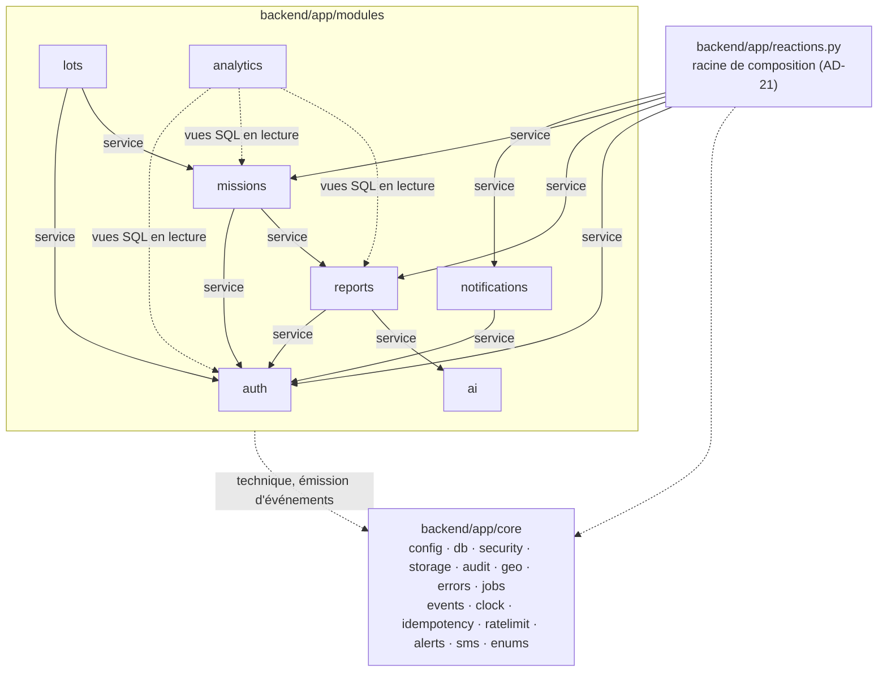
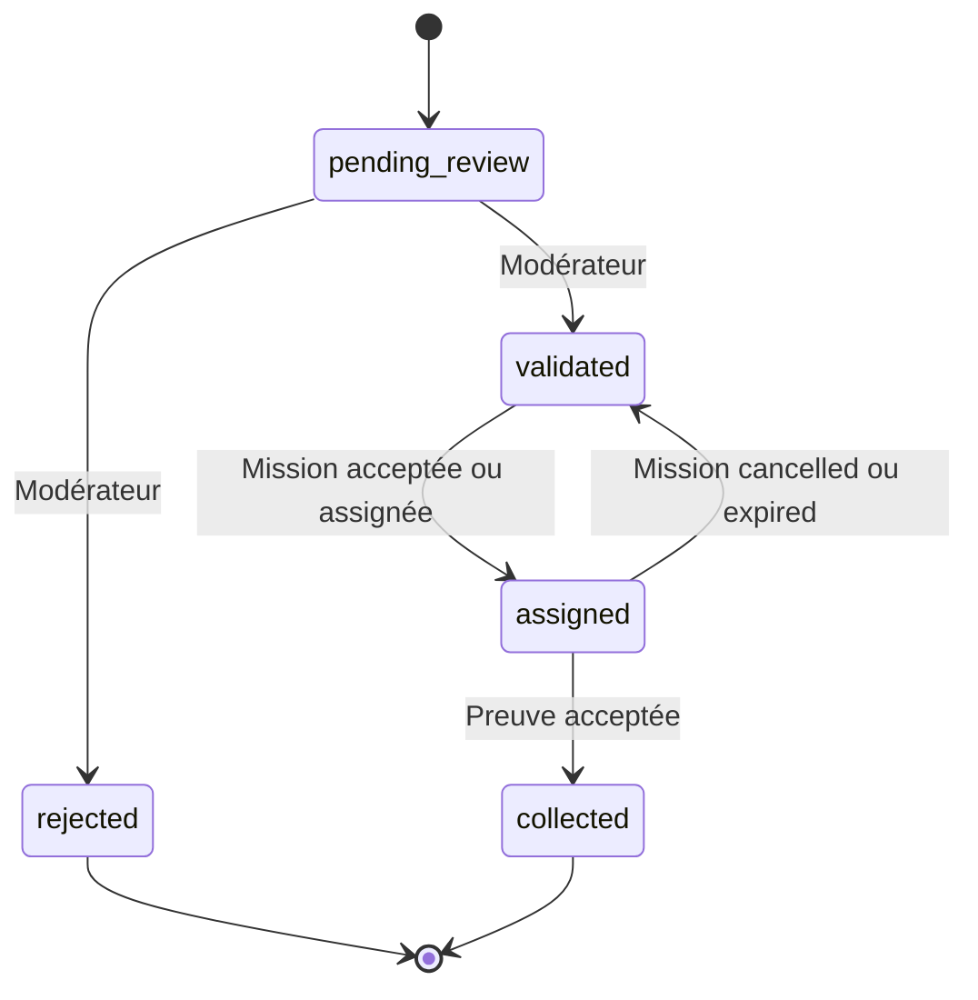
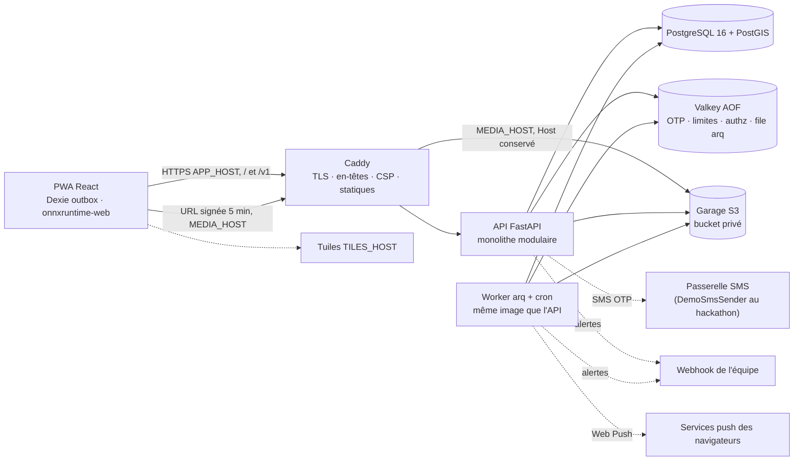
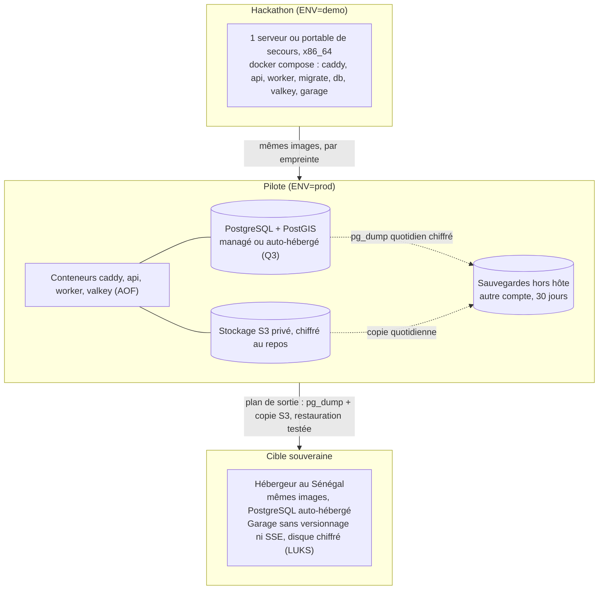
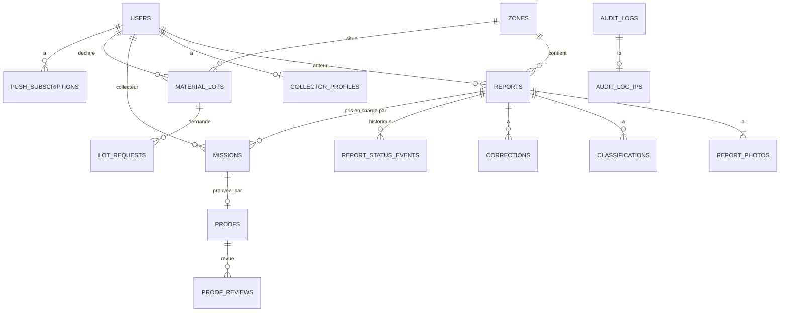

# Épine d'architecture — TerangaCycle AI

> Chaque AD porte **Binds** (ce qu'elle lie), **Prevents** (la divergence empêchée) et **Rule** (la règle). Les termes en majuscule sont ceux du Glossaire du PRD (§3). Les raisons sont dans `.memlog.md`.
>
> Priorité des sources : PRD > addendum > dossier technique. Pour les noms et formes fixés ici, l'épine remplace l'addendum.

## Paradigme

**Monolithe modulaire** : un déploiement, des modules métier aux frontières strictes, trois couches par module.

| Couche | Rôle | Contenu |
|---|---|---|
| `router` | HTTP | Schémas Pydantic, dépendances d'authentification, aucune logique métier |
| `service` | Métier | Règles, transitions ; **seule surface publique du module** |
| `repository` | Données | SQLAlchemy et GeoAlchemy2, tables du module seulement |

`core` fournit les briques techniques, sans règle métier. `reactions.py` compose les réactions inter-modules (AD-21).



Flèches pleines : appels de service autorisés. Pointillés vers `core` : dépendance technique. Toute autre dépendance entre modules est interdite, cycles compris. `core` ne dépend d'aucun module.

## Invariants et règles

### AD-1 — Frontières de module `[ADOPTED]`

- **Binds:** tout le backend.
- **Prevents:** le couplage par la base et la logique métier dans les routes.
- **Rule:**
  - Un module n'importe d'un autre que `app.modules.<x>.service`, selon les flèches pleines ; jamais ses modèles, son repository ni son router.
  - Les routes n'appellent que leur propre service.
  - Seuls `reactions.py` et `worker.py` composent plusieurs modules hors des flèches.
  - import-linter (`layers`, `acyclic_siblings`, `protected`) fait échouer la CI à toute violation.

### AD-2 — Propriété des données

- **Binds:** schéma, migrations, tous les modules.
- **Prevents:** deux modules qui écrivent la même entité avec des règles différentes.
- **Rule:** chaque table a **un seul** module propriétaire, seul à y écrire ; les autres passent par son service.

| Propriétaire | Tables |
|---|---|
| `auth` | `users`, `collector_profiles`, `refresh_tokens`, `devices`, `staff_second_factors` |
| `reports` | `reports`, `report_photos`, `classifications`, `corrections`, `report_status_events`, `tracking_counters`, `weight_estimates` |
| `missions` | `missions`, `proofs` (photos avant/après en colonnes), `proof_reviews` |
| `lots` | `material_lots`, `lot_requests` |
| `notifications` | `notifications` (journal d'envoi push), `push_subscriptions` |
| `core/audit` | `audit_logs` (ajout seul), `audit_log_ips` (AD-25) |
| `core/idempotency` | `idempotency_records` (AD-5) |
| `core/geo` | `zones` (lecture seule, chargée par migration ou seed) |

`analytics` ne possède que des vues (AD-22) ; `ai`, aucune table. Noms faisant foi, qui remplacent l'addendum : `proofs`, `proof_reviews` (une ligne par revue), `staff_second_factors`, champ `classification_status` au premier niveau, `ENV=prod`.

### AD-3 — Une seule porte pour les Statuts

- **Binds:** FR-5, FR-21, FR-23, FR-25, FR-26, FR-29, FR-31, FR-36, FR-42.
- **Prevents:** des transitions concurrentes ou non auditées, un historique des Statuts reconstruit par chaque lecteur, et des interblocages.
- **Rule:**
  - Le Statut ne change que par `reports.service.transition(report_id, from_status, to_status, actor, reason, set_fields=None)` ; le Statut de Mission, que par `missions.service.transition(...)`.
  - Dans l'unité de travail courante (AD-17), chaque transition fait :
    - `UPDATE … WHERE id = :id AND status = :from` (plus `set_fields`) ; 0 ligne : 409 `invalid_transition` ;
    - pour un Signalement, une ligne `report_status_events(report_id, from_status, to_status, reason, actor_kind, occurred_at)` ;
    - une entrée `core.audit.record()` (AD-25) ;
    - notifications et réactions par `after_commit` seulement.
  - `report_status_events` est l'unique historique : jalons de FR-31, détail du Personnel (FR-36), `GET /v1/reports/mine/changes?cursor=` pour FR-21 (compte ou appareil). `audit_logs` n'est jamais lu pour calculer.
  - Verrous : ligne `missions` d'abord, puis `reports`. Le géorepérage de la Preuve suit le verrou de la Mission.
  - Retrait (FR-5) : `reports.service.withdraw()`, propriétaire, `pending_review` seulement ; pas une transition : ligne, photos, Classifications et événements supprimés ; audit `report.withdrawn`.
  - Une table de transitions constante par machine à états, testée sur chaque couple.



### AD-4 — Acceptation de Mission exclusive `[ADOPTED]`

- **Binds:** FR-25, FR-28.
- **Prevents:** deux Missions `active` sur un Signalement, et un renvoi légitime refusé.
- **Rule:**
  - Garantie : index unique partiel `missions(report_id) WHERE status = 'active'`.
  - Insertion de la Mission puis `reports.service.transition(validated → assigned)`, dans la même unité de travail (AD-17).
  - Violation d'unicité : Mission `active` du même Collecteur → 200 avec elle (FR-25) ; sinon 409 `mission_already_taken`.
  - Aucun verrou applicatif ne remplace l'index.

### AD-5 — Idempotence et rejeu

- **Binds:** FR-9, FR-18, FR-25, FR-29, toute route qui modifie l'état.
- **Prevents:** les doublons après coupure, la fuite S1, deux implémentations de l'idempotence, un double appui qui passe deux fois.
- **Rule:**
  - **Signalements :** unique `(owner_key, client_uuid)`. `owner_key` = `user:<id>` si et seulement si un jeton d'accès valide est présent, sinon `device:<device_hash>` (AD-9) ; immuable. Même `owner_key` : 200 avec l'existant ; autre : 409 `client_uuid_conflict`, sans contenu.
  - **Toute autre requête `POST`, `PUT`, `PATCH` ou `DELETE` sous `/v1`** exige `Idempotency-Key` (UUID) via `core.idempotency.require_key`, sinon 400 `idempotency_key_required`. Exemptions closes : `/v1/auth/*`, `POST /v1/reports`. Test sur la table des routes.
  - Stockage en base uniquement : `idempotency_records(principal_key, route_template, key, request_sha256, response_status, response_body, created_at)`, clé primaire sur les trois premiers champs, insérée en début de transaction métier (`ON CONFLICT DO NOTHING`), réponse écrite avant le commit ; seules les 2xx survivent.
  - Même clé : même empreinte → réponse rejouée ; autre empreinte → 422 `idempotency_key_reused`. Purge à 24 h (AD-18).
  - Clés naturelles maintenues : `UNIQUE (proofs.mission_id)`, index d'AD-4.

### AD-6 — Le serveur fait autorité

- **Binds:** FR-7, FR-14, FR-15, FR-29, FR-31.
- **Prevents:** la falsification d'un horodatage, d'une distance ou d'une Classification.
- **Rule:**
  - Calculés par le serveur, seuls utilisés pour décider ou compter : horodatages (`core.clock`), Numéro de suivi (AD-18), Classification serveur, distance (`ST_Distance` sur `geography`), appartenance à la Zone active (`ST_Covers(zones.geog, reports.geog)`), Statuts.
  - Les valeurs du client vont dans des colonnes `client_` (AD-19) : affichage, Désaccord IA et analyse seulement.

### AD-7 — Contrat du Modèle

- **Binds:** FR-11 à FR-16, SM-2.
- **Prevents:** des Désaccords IA artificiels, et un manifeste lu différemment par `ml/`, l'API et la PWA.
- **Rule:**
  - Un Modèle = `tc-mnv3-<semver>.onnx` + manifeste `tc-mnv3-<semver>.json`, validé en CI contre `ml/contract/model-manifest.schema.json` (`schema_version: 1`) : sortie de `ml/export.py` et deux chargeurs.
  - Champs : `model_version`, `kind` (`trained`, `fake`), `onnx_sha256`, `classes` (codes `WasteType` dans l'ordre des sorties), `input` (`size`, `layout: NCHW`, `color: RGB`, `scale: 0-1`, `mean`, `std`, `resize`, `interpolation`), `output.kind: logits`, `temperature`, `confidence_threshold` (0,60).
  - Les deux côtés calculent `softmax(logits / temperature)` et `needs_user_choice = confidence < confidence_threshold` ; le seuil ne vient que du manifeste.
  - Mêmes octets : la PWA classe le JPEG qu'elle envoie (orienté, compressé) ; le serveur, la photo stockée après `ImageOps.exif_transpose()`.
  - Test doré CI : 20 images, trois chaînes (évaluation `ml/`, onnxruntime, onnxruntime-web sous Node) à la même version d'ORT, artefact INT8 réel (QDQ statique) ; même `predicted_type`, écart ≤ 0,01 par classe.
  - Interface `classify(image) → {predicted_type, confidence, scores, model_version, needs_user_choice}`, implémentée aussi par le Modèle factice (`kind: fake`, `0.0.0-stub`).

### AD-8 — Travail asynchrone

- **Binds:** FR-14, FR-21, NFR-2, NFR-16.
- **Prevents:** une API bloquée par l'IA, des notifications abandonnées par un `job_id` réutilisé, des effets en double.
- **Rule:**
  - Classification serveur, miniatures, notifications et réactions sont des tâches **arq**, mises en file par `after_commit` (AD-17) ; les traitements périodiques relèvent d'AD-18.
  - `job_id` : `classify:<report_id>:<model_version>`, `thumb:<photo_id>`, `notify:<status_event_id>`, `react:<event_id>` ; jamais `<type>:<entity_id>` pour un événement.
  - Le `job_id` ne déduplique que les mises en file concurrentes (il expire avec `keep_result`) : l'effet est idempotent dans le service (écriture conditionnelle ou contrainte unique, par exemple `notifications.status_event_id`) ; la tâche relit l'état et s'arrête s'il est dépassé.
  - Une tâche passe par les services, sans logique propre.
  - `reports.classification_status ∈ {pending, done, failed}` ; le 201 renvoie `pending`, le client lit par `GET`.
  - Mise en file seulement sous `CLASSIFY_QUEUE_MAX` (500) ; sinon `pending` reste et `classification_queue_full` part (AD-27). `classify` a `keep_result = 0`.

### AD-9 — Identité et autorisation

- **Binds:** FR-1 à FR-3, FR-9, FR-20, NFR-9, S4 à S6.
- **Prevents:** des jetons exposés au XSS, des contrôles d'accès propres à chaque route, et plusieurs empreintes ou un format faible pour l'Identifiant d'appareil.
- **Rule:**
  - **Accès :** JWT de 15 min, Ed25519 (`alg: EdDSA`), avec `iss`, `aud`, `kid`, `sub`, `tv`, `amr`, décodé avec `algorithms=["EdDSA"]` ; en mémoire dans la PWA. Révocation et Second facteur : AD-30.
  - **Renouvellement :** opaque, rotatif, haché, par famille ; cookie `HttpOnly; Secure; SameSite=Strict; Path=/v1/auth` sur l'origine unique (AD-23).
  - **Identifiant d'appareil :** `X-Device-Id` = 32 octets aléatoires en base64url (43 caractères), générés au premier lancement, gardés dans la table Dexie `meta` (seule exception au test de FR-2) ; autre format : 400 `invalid_device_id`.
  - **Principal unique :** seule `core.security.principal()` lit `Authorization` et `X-Device-Id` et renvoie `Principal(kind, user_id, role, device_hash, owner_key)`, avec `device_hash = HMAC-SHA256(DEVICE_ID_PEPPER, id)`. Débit, AD-5 et idempotence le réutilisent.
  - `devices(device_hash, training_consent, consent_at, first_seen_at)` n'est écrite que par `auth.service.touch_device()`, appelée par `reports.service.create()`.
  - **Autorisation en deux temps :** `require_role(...)` dans le router, puis contrôle de propriété dans le service avant toute lecture (404 sinon).
  - **Liste blanche publique (close) :** `/healthz`, `/readyz`, `GET /v1/config`, `POST /v1/reports`, `GET /v1/public/map`. **Principal appareil**, testé comme un rôle : `GET /v1/reports/mine`, `GET /v1/reports/mine/changes`, `DELETE /v1/reports/<id>`, `PUT /v1/device/consent`.
  - Le test « route × rôle » est généré depuis la table des routes.

### AD-10 — Exposition des Positions et des données personnelles

- **Binds:** FR-24, FR-27, FR-29, FR-33, FR-34, FR-39, §6.1 du PRD, S8, S9.
- **Prevents:** qu'un sérialiseur expose une Position précise, une distance qui la trahit, ou une identité à un public non autorisé.
- **Rule:**
  - Toute Position passe par `core.geo.expose(position, level)`. Le niveau se calcule dans le service, d'après le principal **et** le Statut de Mission courant :

    | Niveau | Destinataires | Précision |
    |---|---|---|
    | `precise` | Personnel ; Collecteur d'une Mission **`active`** sur ce Signalement ; auteur (sa Position) | Exacte |
    | `approx` | Collecteur vérifié sans cette Mission `active` | 3 décimales ; distance arrondie à 100 m, calculée sur la Position exacte |
    | `rounded` | Exports agrégés (FR-33) | 3 décimales |
    | `aggregated` | Visiteurs (FR-34) | Cellules ≥ 500 m, ≥ 3 Signalements |
    | `none` | Tout autre rôle | Aucune |

  - Position du Collecteur et photos de Preuve : Personnel et Collecteur de la Mission seulement (FR-29).
  - La Position de recherche (FR-24) n'est ni stockée ni journalisée.
  - Auteur et `owner_key` : jamais hors du Personnel. Lots : aucune identité de Collecteur ; contact après demande seulement, via `auth.service.get_contact()`.
  - Photos lues par URL signée de 5 min sur `MEDIA_HOST` (AD-13). Téléphone en HMAC (`PHONE_PEPPER`) et AES-GCM (AD-26).
  - `structlog` masque `phone`, `token`, `otp`, `X-Device-Id` et toute Position.
  - Le test « jamais plus de 3 décimales » couvre toutes les réponses d'un Collecteur sans la Mission `active`, distances comprises.

### AD-11 — Conventions d'API `[ADOPTED]`

- **Binds:** toutes les routes et le client PWA.
- **Prevents:** des contrats incohérents, deux protocoles d'envoi de photo, un client désynchronisé.
- **Rule:**
  - Préfixe `/v1`. Enveloppe d'erreur `{"error": {"code", "message", "request_id"}}` ; codes en énumération unique (`core/errors/codes.py`) exportée dans l'OpenAPI ; la CI exige `errors.<code>` dans `fr.json`.
  - Pagination `?limit=&cursor=`, `limit` ≤ 100, réponse `{items, next_cursor}`.
  - **Photos :** uniquement par l'API, en `multipart/form-data`, dans la requête de création : `POST /v1/reports` (`meta`, `photo`), `POST /v1/missions/<id>/proof` (`meta`, `photo_before`, `photo_after`), `POST /v1/lots` (`meta`, `photo`). Aucune URL présignée en écriture.
  - **Client :** `backend/scripts/export_openapi.py` écrit `web/src/api/openapi.json` depuis l'application ; types par `openapi-typescript` ; seul client HTTP, une instance `openapi-fetch` enveloppée dans `web/src/api/` (jeton, `X-Device-Id`, `Idempotency-Key`, erreurs). Fichiers versionnés ; la CI échoue si la régénération diffère.
  - ESLint interdit `fetch` hors de `web/src/api/` et `web/src/offline/`.

### AD-12 — Outbox hors-ligne

- **Binds:** FR-17 à FR-19, NFR-4.
- **Prevents:** des files divergentes, un renvoi sous une autre identité, des réessais sans fin.
- **Rule:**
  - **Une seule outbox Dexie**, exécutée dans la fenêtre (`online`, ouverture, « Réessayer »), jamais dans le service worker.
  - Chaque élément porte sa clé idempotente et son **identité figée à la mise en file** :
    - `device` : envoyé avec `X-Device-Id` seul, sans `Authorization` ;
    - `user:<id>` : envoyé seulement avec une session de cet utilisateur (et `X-Device-Id`) ; sinon « en attente de connexion », pas un échec.
  - Backoff exponentiel plafonné **uniquement** sur erreur réseau, 408, 429 (avec `Retry-After`) ou 5xx.
  - 401 : `refreshSession()` (AD-30), puis un seul réessai.
  - Autre 4xx : état `failed`, hors du compteur de FR-19, code affiché.
  - Photos compressées à 300 Ko ou moins **avant** l'entrée.

### AD-13 — Stockage objet

- **Binds:** FR-8, FR-23, FR-29, FR-38, FR-41, NFR-8, NFR-17.
- **Prevents:** des clés incohérentes, des empreintes incomparables, des URL signées injoignables, des objets orphelins.
- **Rule:**
  - Seul `core/storage` parle S3 (boto3), configuré explicitement : `region_name` du stockage (`garage`), `signature_version="s3v4"`, `addressing_style="path"`, sommes de contrôle de requête et de réponse en `"when_required"`.
  - Deux clients : `S3_INTERNAL_ENDPOINT` écrit ; `S3_PUBLIC_BASE_URL` (`MEDIA_HOST`, relayé par Caddy sans réécriture ni changement de `Host`) signe les lectures.
  - `core.storage.ingest_photo(bytes, kind) → {object_key, sha256, width, height}` : refus au-delà de 1 Mo ou 12 Mpx (413 ou 422) avant S3 ; ré-encodage JPEG sans EXIF ; `sha256` des **octets reçus**, indexé (`report_photos.sha256`, `proofs.before_sha256`, `proofs.after_sha256`).
  - Clés `<kind>/<yyyy>/<mm>/<uuid>.jpg`, `<kind> ∈ {report, report_thumb, before, after, lot}`, mois UTC, `<uuid>` de la ligne photo, qui garde `object_key` et `thumb_key`.
  - Photo identique : seulement `reports.service.photo_seen(sha256)` et `missions.service.photo_seen(sha256)`.
  - `core.storage.purge()` supprime objet et miniature par `after_commit` ; `after_rollback` nettoie ; balayage des orphelins de plus de 24 h (AD-18). Aucun versionnage supposé.
  - Bucket privé ; test d'intégration CI sur `dxflrs/garage:v2.5.0` (put, get, head, delete, presign GET).

### AD-14 — Configuration et modes

- **Binds:** FR-1, FR-6, FR-37, la Zone active, NFR-7.
- **Prevents:** le Mode démonstration en production, des étiquettes de démonstration divergentes, un OTP de démo codé dans le service, des réglages dispersés.
- **Rule:**
  - Toute configuration passe par `core.config.Settings` (pydantic-settings) ; secrets : AD-26.
  - `ENV ∈ {dev, demo, prod}`. `DEMO_MODE` est la **seule** source du Mode démonstration : permis si `ENV ∈ {dev, demo}`, exigé par `ENV=demo`, sinon démarrage refusé.
  - `is_demo NOT NULL DEFAULT false` sur `users`, `reports`, `missions`, `proofs`, `proof_reviews`, `material_lots`, `lot_requests`, `audit_logs` ; valeur `core.demo.flag(parent_is_demo)` (`DEMO_MODE` ou étiquette du parent) ; exposé dans les réponses.
  - `GET /v1/config` (public, servi par `auth`) : `demo_mode`, `env`, `model_version`, polygone simplifié de la Zone active (`ACTIVE_ZONE_ID`), précaché par la PWA.
  - **SMS :** seul `core.sms.SmsSender` envoie : `DemoSmsSender` (champ `demo_otp`, absent du schéma hors démo) ou `GatewaySmsSender`, selon `SMS_BACKEND` ; le plafond de FR-1 est vérifié dans ce port.
  - `python -m app.cli demo load|purge`, refusé si `ENV=prod` ; `purge` (rôle `teranga_migrator`) supprime les lignes `is_demo` et leurs objets, jamais `audit_logs`.
  - Un réglage nommé distinct par seuil du PRD ; les quatre « 50 m » : `REPORT_ACCURACY_FLAG_M`, `PROOF_REPORT_ACCURACY_CAP_M`, `PROOF_COLLECTOR_ACCURACY_MAX_M`, `DUPLICATE_RADIUS_M`. `CONFIDENCE_THRESHOLD` ne fait que vérifier le manifeste au démarrage.

### AD-15 — Base de données et migrations

- **Binds:** NFR-17, FR-36.
- **Prevents:** un schéma modifié hors migration, un Journal d'audit modifiable, un retour arrière cassé par une migration.
- **Rule:**
  - Alembic est le **seul** chemin de modification du schéma.
  - `teranga_migrator` possède le schéma ; `teranga_app` fait du DML **sans** `UPDATE` ni `DELETE` sur `audit_logs` (`DELETE` seulement sur `audit_log_ips`).
  - Service `migrate` à usage unique avant la nouvelle version. Migrations **expand/contract** : jamais de suppression ni de renommage d'une colonne lue par la version N-1.
  - Une migration qui touche une table lue par une vue appelle `recreate_analytics_views()` (AD-22).
  - Test CI : création de table et mise à jour du Journal refusées à `teranga_app`.

### AD-16 — Organisation de la PWA

- **Binds:** web/, FR-11, FR-17, FR-21, NFR-5, NFR-12, NFR-13.
- **Prevents:** des chaînes en dur, des jetons dispersés, un Modèle absent du cache, un runtime IA bloqué par la CSP.
- **Rule:**
  - Un dossier par fonctionnalité dans `web/src/features/`, aligné sur les modules.
  - Tout texte par i18next (`fr.json`, `wo.json`), libellés des énumérations compris.
  - Jetons de design (dont `--color-brand-600: #187A50`) dans **un seul** bloc `@theme` de `web/src/theme/theme.css`, via `@tailwindcss/vite` ; ni `tailwind.config.js` ni `@config`.
  - Runtime importé par `onnxruntime-web/wasm` ; `wasmPaths` vers la PWA ; `numThreads = 1`, `proxy = false`.
  - Précache : `globPatterns` avec `onnx,json,wasm,mjs`, `maximumFileSizeToCacheInBytes` à 20 Mio ; un test CI vérifie la présence du `.onnx`, du manifeste et de `ort-wasm-simd-threaded.{wasm,mjs}`.
  - Modèle chargé paresseusement depuis le précache par `features/classify`.
  - Carte : react-leaflet ; `leaflet.heat` 1.0 (ESM) enveloppé par `createLayerComponent`.
  - FR-21 : derniers Statuts vus mémorisés dans Dexie, anonyme compris.

### AD-17 — Unité de travail et effets après commit

- **Binds:** tous les services, `core/db`, `core/jobs`, `core/storage`, AD-3, AD-4, AD-8.
- **Prevents:** une transaction validée à moitié entre deux services, et des effets émis pour une transaction annulée.
- **Rule:**
  - Une session et une transaction par requête ou par tâche, dans un `contextvar` de `core.db`, ouvertes par `get_uow()` ou par l'entrée de la tâche.
  - Les méthodes publiques de service (`@core.db.transactional`) rejoignent la transaction en cours ; seul le niveau externe valide ou annule. Jamais de `commit`, `rollback` ni `begin` dans un service ou un repository.
  - Tout effet externe (file arq, push, suppression S3) passe par `core.db.after_commit(fn, ...)`, exécuté après le commit externe, abandonné au rollback. `after_rollback` ne nettoie que les objets S3 écrits.
  - Test : une exception après `reports.service.transition()` dans `missions.service.accept()` ne laisse ni écriture, ni tâche, ni audit.

### AD-18 — Temps, horloge et tâches planifiées

- **Binds:** FR-5, FR-7, FR-14, FR-23, FR-31, FR-41, FR-42, §6.1 du PRD.
- **Prevents:** deux horloges, des tests à horloge simulée impossibles, trois mécanismes de planification, des échéances perdues.
- **Rule:**
  - Tout « maintenant » vient de `core.clock.now()` (UTC), passé en paramètre aux requêtes ; jamais `datetime.now()` ni `NOW()` pour une règle métier.
  - Périodes en UTC. Année du Numéro de suivi = celle de `received_at` ; compteur par `INSERT … ON CONFLICT (year) DO UPDATE … RETURNING n`.
  - Traitements périodiques : `cron_jobs` arq de `worker.py`, idempotents, sur les lignes échues ; ni cron d'hôte ni `_defer_until`. Liste close :

    | Tâche | Fréquence | Propriétaire | Exigence |
    |---|---|---|---|
    | `missions.expire_due` | 1 min | `missions` | FR-42 |
    | `reports.requeue_pending_classifications` | 1 min | `reports` | FR-14 |
    | `reports.purge_person_visible_photos` | 1 h | `reports` | FR-23 |
    | `retention.sweep` (`purge_expired(now)` de chaque propriétaire) | 1 jour | `reports`, `missions`, `core/audit`, `core/idempotency`, `core/storage` | §6.1, AD-5, AD-13 |
    | `auth.purge_deleted_accounts` | 1 jour | `auth` | FR-5 |
    | `missions.sample_proofs` (`secrets.SystemRandom`) | lundi | `missions` | FR-41 |
    | `ops.health_sweep` | 1 min | `core/alerts` | NFR-16 |

  - Durées du §6.1 en réglages nommés (`RETENTION_*`, `ACCOUNT_PURGE_DAYS`).
  - Acteur d'audit d'une tâche : `system:<nom_de_tâche>`.
  - Après une restauration, `retention.sweep` tourne avant la réouverture.

### AD-19 — Classifications, Corrections et drapeaux

- **Binds:** FR-12 à FR-15, FR-22, FR-23, FR-13.
- **Prevents:** deux formes d'une Classification, un Désaccord IA calculé de deux façons, un Type de déchet retenu écrit hors de la porte des Statuts.
- **Rule:**
  - **Locale :** dans `reports` seulement : `client_predicted_type`, `client_confidence`, `client_model_version` (nuls ou renseignés ensemble, `CHECK`), `citizen_type` (nul si la proposition est gardée), colonne générée `device_type = coalesce(citizen_type, client_predicted_type)`.
  - **Serveur :** `classifications(report_id, model_version, predicted_type, confidence, scores, created_at)`, unique `(report_id, model_version)`, écrite par `reports.service.record_server_classification()` seulement.
  - **Corrections :** `corrections(report_id, actor_kind, original_type, original_source, model_version, corrected_type, created_at)`, écrite à la création (`citizen_type` ≠ `client_predicted_type`) ou à la validation (`retained_type` ≠ type pré-rempli), jamais ailleurs.
  - **Type de déchet retenu :** seulement par `reports.service.validate()`, via `transition(pending_review → validated)` avec `retained_type` dans `set_fields` ; `CHECK` non nul dès `validated`.
  - **Drapeaux :** colonnes indexées de `reports`, écrites par `reports.service`, jamais recalculées à la lecture :
    - à la création, sans bloquer : `flag_low_confidence`, `flag_imprecise_position`, `duplicate_of_report_id` (photo identique, ou `ST_DWithin` de `DUPLICATE_RADIUS_M` sur les non terminaux reçus depuis `DUPLICATE_WINDOW_H`) ;
    - à la Classification serveur : `flag_ai_disagreement` = `NULL` si `client_model_version` est nul ou différent de la version serveur, sinon `device_type <> predicted_type`.

### AD-20 — Limitation de débit et IP du client

- **Binds:** FR-1, FR-10, S6, S7, NFR-16.
- **Prevents:** une IP falsifiable, des compteurs perdus au redémarrage, des limites codées route par route.
- **Rule:**
  - Limitation **dans l'API** seulement, par `core.ratelimit.limit(scope)` sur Valkey (atomique, fenêtre fixe) ; jamais dans Caddy ; plafonds en réglages nommés.
  - uvicorn `--proxy-headers --forwarded-allow-ips=<IP de Caddy>`, jamais `*` ; Caddy **remplace** `X-Forwarded-For` ; le code ne lit que `request.client.host`.
  - Portées (clés hachées) : `otp:phone` 5/h, `otp:device` 5/h, `otp:ip` 20/h, `sms:daily` (au-delà de `SMS_DAILY_CAP` : 503 `sms_cap_reached` et alerte), `report:device`, `report:ip`, `report:user` 10/h, `user:any` 60/min.
  - 429 `rate_limited` avec `Retry-After`.
  - OTP haché dans Valkey, TTL 5 min, comparaison à temps constant, invalidé au 5ᵉ échec.
  - Valkey en AOF (`appendonly yes`, volume) partout.

### AD-21 — Réactions inter-modules et événements

- **Binds:** AD-1, AD-8, FR-4, FR-5, FR-21, FR-35, FR-40.
- **Prevents:** un cycle d'imports, une règle métier dans une clé étrangère, une suppression de compte faite module par module, des contenus de tâche divergents.
- **Rule:**
  - Événements autosuffisants, modèles Pydantic de `core/events.py` : `ReportStatusChanged` (`event_id` de `report_status_events`, Numéro de suivi, `owner_key`, `author_user_id`, `to_status`, `reason`), `MissionAssigned`, `AccountDeleted`, `TrainingConsentWithdrawn`, `CollectorSuspended`, `LotReserved`.
  - Émis par `core.events.emit()` sous `after_commit` ; tâche `react:<event_id>`.
  - Réactions idempotentes, seulement dans `reactions.py` : `ReportStatusChanged` → `notifications.service.push()` ; `AccountDeleted` → `missions.service.on_collector_deleted()` (Mission `active` annulée) puis `reports.service.detach_owner()` ; `TrainingConsentWithdrawn` → `reports.service.revoke_training_consent()`.
  - **Suppression de compte (FR-5) :** `auth.service.delete_account()` efface `phone_hash` et `phone_enc`, incrémente `token_version`, révoque les familles et émet `AccountDeleted`. `detach_owner` supprime les Signalements `pending_review` et `rejected` (ligne et photos) et met `author_user_id` à `NULL` ailleurs, `owner_key` gardé. `users` purgé après `ACCOUNT_PURGE_DAYS`.
  - Aucune clé étrangère `ON DELETE CASCADE` ni `SET NULL` entre modules.

### AD-22 — Vues analytiques et indicateurs

- **Binds:** AD-2, AD-15, FR-31 à FR-34, FR-37, FR-41.
- **Prevents:** une vue cassée par la migration d'un autre module, des indicateurs sur colonnes implicites, des chiffres de démonstration présentés comme réels.
- **Rule:**
  - `v_report_facts`, `v_mission_facts`, `v_collector_facts` appartiennent à `analytics`, dans `modules/analytics/views/*.sql`, avec une liste de colonnes déclarée ; `recreate_analytics_views()` les recrée, sans `CASCADE`.
  - `v_report_facts` : jalons de `report_status_events` (`received_at`, `validated_at`, `rejected_at`, `assigned_at`, `collected_at`). `v_mission_facts` : `accepted_at`, `weight_kg`, `weight_kind`, `review_status`, `retained_type`. `v_collector_facts` : Collecteurs vérifiés.
  - Kg collectés hors `review_status = 'contested'`.
  - Vues sans donnée personnelle, avec `is_demo` ; hors Mode démonstration, filtre `is_demo = false` ; chaque réponse porte `contains_demo_data`.
  - CI : `alembic upgrade head`, puis chaque vue vérifiée contre son contrat sur le jeu de démonstration.

### AD-23 — Bord HTTP : origines, en-têtes, exposition et journaux du proxy

- **Binds:** NFR-7, NFR-8, NFR-14, S7, S11, AD-9.
- **Prevents:** des en-têtes posés deux fois, une CSP affaiblie, une surface interne exposée, des données personnelles dans les journaux du proxy, un cookie cassé par des origines séparées.
- **Rule:**
  - Une seule origine `https://<APP_HOST>` pour la PWA et `/v1` (pas de CORS en production) ; photos sur `https://<MEDIA_HOST>`, domaine distinct sans cookie ; tuiles sur `<TILES_HOST>`.
  - **Caddy seul** pose HSTS, CSP, `nosniff`, `Referrer-Policy: no-referrer` et la redirection HTTPS (TLS 1.2 minimum).
  - CSP (`infra/Caddyfile`) : `default-src 'self'; script-src 'self' 'wasm-unsafe-eval'; img-src 'self' blob: data: https://<MEDIA_HOST> https://<TILES_HOST>; connect-src 'self' https://<MEDIA_HOST>; worker-src 'self'; object-src 'none'; base-uri 'none'; frame-ancestors 'none'`. Pas de COOP/COEP ; `.wasm` en `application/wasm`.
  - Caddy publie `/`, `/v1/*` hors `/v1/ai/*`, et `MEDIA_HOST` ; `/metrics` et `/v1/ai/*` restent internes ; corps borné par `MAX_BODY_BYTES`.
  - Hors `ENV ∈ {dev, demo}`, `docs_url`, `redoc_url` et `openapi_url` valent `None`.
  - Journaux d'accès Caddy sans `Authorization`, `Cookie`, `X-Device-Id`, `Idempotency-Key`, `lat` ni `lng`.
  - Test : chaque en-tête et sa valeur, `/docs` absent en `prod`, `/metrics` et `/v1/ai/*` refusés de l'extérieur.

### AD-24 — Consentement au réentraînement

- **Binds:** FR-4, FR-13, FR-36, §6.3 du PRD.
- **Prevents:** un Signalement exporté après retrait du consentement, et un consentement stocké de trois façons.
- **Rule:**
  - `POST /v1/reports` exige `consent.terms = true` (sinon 422 `consent_required`) et `consent.training`.
  - Valeur courante chez `auth` : `users.training_consent` (+ horodatage) ou `devices.training_consent` (+ `consent_at`) ; retrait par `PUT /v1/me/consent` ou `PUT /v1/device/consent`.
  - `reports.training_consent` = instantané à la création ; un retrait émet `TrainingConsentWithdrawn` (AD-21), qui le passe à faux pour tout l'`owner_key`.
  - L'export des Corrections appartient à `reports` (`export_corrections()`) : `validated` atteint et `training_consent = true` au moment de l'export ; audité ; `ml/` ne lit que ce fichier.

### AD-25 — Journal d'audit

- **Binds:** FR-36, FR-5, FR-13, FR-23, FR-26, FR-35, FR-41, FR-42, FR-43, §6.1 du PRD, NFR-17.
- **Prevents:** des noms d'action divergents, une action de FR-36 non journalisée, des IP impossibles à purger.
- **Rule:**
  - `core.audit.record(action, actor, object_type, object_id, before, after, ip=None)` ; `Actor(kind, ref)`, `kind` parmi `user`, `device`, `system` ; `before`/`after` limités aux champs modifiés, sans donnée personnelle ; horodatage serveur, `request_id`.
  - `AuditAction` (`core/audit/actions.py`), liste close : `report.transition`, `report.correction`, `report.withdrawn`, `mission.transition`, `mission.assign`, `proof.review`, `account.create`, `account.verify`, `account.suspend`, `account.delete`, `account.role_change`, `mfa.enable`, `mfa.reset`, `staff.login`, `export.aggregate`, `export.corrections`, `retention.purge`. Un test vérifie que chacune est produite.
  - `audit_logs` : aucune clé étrangère vers les tables métier.
  - IP dans `audit_log_ips(audit_log_id, ip, created_at)` (`INSERT`, `SELECT`, `DELETE` pour `teranga_app`), purgée à 6 mois ; `audit_logs` reste en ajout seul.
  - Purges auditées par lot (nombre, catégorie).

### AD-26 — Secrets et clés

- **Binds:** NFR-10, NFR-17, §6.4 du PRD, AD-9, AD-10, AD-30.
- **Prevents:** des secrets dans Git ou les images, des données illisibles après rotation, des clés sans propriétaire.
- **Rule:**
  - Inventaire fixe, lu par `Settings` depuis `/run/secrets/*` : `JWT_SIGNING_KEYS` (Ed25519, par `kid`), `PHONE_PEPPER`, `DEVICE_ID_PEPPER`, `PHONE_ENC_KEYS`, `TOTP_ENC_KEY`, `VAPID_PRIVATE_KEY`, identifiants S3, `ALERT_WEBHOOK_URL`.
  - Hackathon : `.env.secrets` hors Git. Pilote : KMS ou gestionnaire de secrets de l'hébergeur, clés détenues par l'organisation.
  - JWT : la clé la plus récente signe, toutes vérifient ; rotation par ajout d'un `kid`.
  - AES-GCM : chaque valeur porte `key_id` et `nonce` ; rotation par ajout, ancienne clé en lecture jusqu'à réécriture.
  - Un pepper HMAC ne change jamais sans migration de recalcul.
  - En `demo` et `prod`, un secret manquant bloque le démarrage ; seul `dev` génère des valeurs éphémères.

### AD-27 — Supervision, alertes et sauvegardes

- **Binds:** NFR-7, NFR-14 à NFR-17, FR-1, FR-14, §6.4 du PRD.
- **Prevents:** des alertes émises différemment par module, des seuils non mesurables, des photos sans sauvegarde, une restauration jamais éprouvée.
- **Rule:**
  - Seul `core.alerts.raise_alert(code, context)` alerte ; codes clos `sms_cap_reached`, `classification_queue_full`, `http_5xx_rate`, `backup_failed`, `disk_high` ; canal unique `ALERT_WEBHOOK_URL` ; une alerte par code et par 15 min ; un test de déclenchement simulé par alerte.
  - `/metrics` interne (requêtes par statut, latence, file arq) ; `ops.health_sweep` calcule le taux de 5xx sur 5 min et le disque.
  - `/healthz` : vivacité. `/readyz` : base, Valkey, stockage, `onnx_sha256`, battement `worker:heartbeat` de moins de 60 s ; statut global seulement.
  - Sauvegardes (pilote) : `pg_dump -Fc` quotidien chiffré (clé de l'organisation) et copie quotidienne du bucket hors de l'hôte, sur un autre compte ; `BACKUP_RETENTION_DAYS` = 30 ; échec → `backup_failed`.
  - Restauration complète sur un hôte vierge, consignée avant la première donnée réelle et avant la fin du pilote.
  - Chiffrement au repos (pilote) : base, sauvegardes et photos ; avec Garage (ni versionnage ni SSE), disque chiffré (LUKS).

### AD-28 — Publication, CI/CD et retour arrière

- **Binds:** NFR-10, NFR-11, AD-15.
- **Prevents:** une image non reproductible, une action de CI détournée, un retour arrière cassé.
- **Rule:**
  - Images par empreinte (`image@sha256:…`), actions GitHub par SHA de commit ; Dependabot les met à jour ; la CI échoue sur tout élément non épinglé.
  - CI bloquante : ruff, ESLint, pytest, Vitest, couverture ≥ 60 %, import-linter, route × rôle, diff OpenAPI, test doré, intégration Valkey (`valkey/valkey:9.2.0`) et Garage, Gitleaks, pip-audit, npm audit, Trivy (exceptions datées).
  - Sur `main` : une image `ghcr.io/<org>/terangacycle-api:<sha>` (API et worker) et la PWA statique.
  - Déploiement : `IMAGE_TAG=<sha>`, service `migrate`, puis `docker compose up -d`. Retour arrière : `IMAGE_TAG` précédent.

### AD-29 — Distribution et version du Modèle

- **Binds:** FR-14, FR-15, FR-16, NFR-5, AD-7.
- **Prevents:** une API et une PWA qui embarquent deux versions, des Désaccords IA artificiels après une montée de version, des artefacts copiés à la main.
- **Rule:**
  - `ml/release/current.json` est la seule source de la version courante.
  - Artefacts publiés en assets de release GitHub `model-v<semver>`, téléchargés par le Dockerfile de l'API et le build Vite, `onnx_sha256` vérifié ; aucun `.onnx` dans Git ; la CI échoue si les deux versions diffèrent.
  - Le worker garde la version précédente 30 jours ; la Classification serveur utilise `client_model_version` si elle est chargée, sinon la courante (Désaccord `NULL`).
  - La PWA compare son Modèle à `GET /v1/config` et met à jour son service worker s'il diffère.
  - En `dev` et `demo`, `MODEL_VERSION=0.0.0-stub` force le Modèle factice.

### AD-30 — Session : révocation, Second facteur et renouvellement

- **Binds:** FR-2, FR-3, FR-5, FR-35, FR-43, S4, S5.
- **Prevents:** un compte suspendu ou rétrogradé qui agit encore, un Second facteur vérifié selon la route, une famille révoquée par deux renouvellements concurrents.
- **Rule:**
  - **Révocation :** à chaque requête, `principal()` lit `(status, role, token_version)` dans Valkey (`authz:<user_id>`, TTL 60 s, repli en base) ; `status ≠ active` ou `tv ≠ token_version` → 401 `session_revoked`. Le rôle vient de la base, jamais du jeton.
  - Suspension, suppression, changement de rôle, réinitialisation du Second facteur et déconnexion globale incrémentent `token_version`, révoquent les familles et invalident le cache par `after_commit`.
  - **Second facteur :** TOTP RFC 6238 (30 s, ±1), secret chiffré (`TOTP_ENC_KEY`), code rejoué refusé. Le jeton porte `amr` (`otp`, ou `otp` et `totp`), mémorisé par la famille. Si `STAFF_MFA_REQUIRED`, `require_role` du Personnel exige `totp`, sinon 403 `second_factor_required` ; faux par défaut en `dev`/`demo`, forcé vrai en `prod` (pilote).
  - **Renouvellement PWA :** seule `refreshSession()` (`web/src/api/session.ts`) appelle `/v1/auth/refresh` : promesse partagée dans l'onglet, sérialisée entre onglets par `navigator.locks.request('tc-refresh', …)` ; client et outbox l'utilisent.
  - **Grâce serveur :** un jeton de renouvellement réutilisé moins de `REFRESH_REUSE_GRACE_S` (10 s) après rotation → 401 `refresh_superseded`, sans révocation ; au-delà, la famille est révoquée.
  - Durée glissante de 30 jours (FR-2) ; la déconnexion révoque la famille.

## Conventions de cohérence

| Sujet | Convention |
|---|---|
| Nommage | Code et base en anglais ; textes en français via i18n ; tables au pluriel en `snake_case`. |
| Énumérations | Définies une fois dans `core/enums.py`, exportées dans l'OpenAPI, jamais recopiées dans `web/` ou `ml/` ; test `classes` du manifeste = `WasteType`. Statut : `en attente de modération`=`pending_review`, `validé`=`validated`, `assigné`=`assigned`, `collecté`=`collected`, `rejeté`=`rejected`. Statut de Mission : `active`, `terminée`=`completed`, `annulée`=`cancelled`, `expirée`=`expired`. Type de déchet : `plastique`=`plastic`, `métal`=`metal`, `verre`=`glass`, `organique`=`organic`, `mixte`=`mixed`. Taille de tas : `small`, `medium`, `large`. Poids déclaré : `pesé`=`weighed`, `estimé`=`estimated`. Revue de Preuve : `non revue`=`unreviewed`, `confirmée`=`confirmed`, `contestée`=`contested`. Statut de Lot : `disponible`=`available`, `réservé`=`reserved`. Motifs de rejet : `spam`, `not_waste`, `outside_zone`, `duplicate` (avec `duplicate_of_report_id`), `person_or_plate_visible` (purge 24 h), `other` (texte obligatoire). |
| Identifiants | UUID v4 ; Numéro de suivi `TC-AAAA-NNNNNN` pour l'affichage seulement. |
| Temps | `TIMESTAMPTZ` UTC ; ISO 8601 avec `Z` ; « maintenant » via `core.clock`. |
| Géographie | `GEOGRAPHY(Point, 4326)` ; Zones en `GEOGRAPHY(MultiPolygon, 4326)` ; `{lat, lng}` dans l'API ; mètres. |
| Poids | `NUMERIC(8,2)` kg ; pas d'argent au MVP. |
| Erreurs | `DomainError(code, http_status)`, code de `core/errors/codes.py`, un seul gestionnaire ; jamais de `HTTPException` dans un service. |
| Journaux | `structlog` JSON avec `request_id`, `route`, `role`, `duration_ms` ; masquage AD-10 et AD-23. |
| Transactions | Une unité de travail par requête ou tâche (AD-17) ; les services rejoignent celle de l'appelant ; ni service ni repository n'appelle `commit`, `rollback` ou `begin` ; effets externes par `after_commit`. |
| Tests | `pytest` sur PostGIS, Valkey et Garage réels (conteneurs) ; aucun mock de la base pour les règles métier. |
| Front | PascalCase, hooks `useX`, TanStack Query (rafraîchissement 15 s sur le suivi). |

## Stack

Versions vérifiées le 23 novembre 2026 (npm, PyPI, Docker Hub), épinglées dans les fichiers de dépendances.

| Nom | Version |
|---|---|
| Python (`python:3.12.16-slim-trixie`) | 3.12.16 |
| FastAPI | 0.165 |
| Pydantic / pydantic-settings | 2.14 / 2.16 |
| SQLAlchemy | 2.1 |
| GeoAlchemy2 | 0.21 |
| Alembic | 1.20 |
| psycopg | 3.3 |
| arq | 0.28 |
| redis-py (imposé par arq, `redis<6`) | 5.3.1 |
| onnxruntime (CPU, serveur et `ml/`) | 1.31.1 |
| Pillow | 13.0 |
| PyJWT[crypto] / cryptography | 2.15 / 50 |
| boto3 | 1.44 |
| structlog | 26.1 |
| import-linter | 2.17 |
| PostgreSQL + PostGIS (`postgis/postgis`, amd64 seulement) | 16-3.7 |
| Valkey (`valkey/valkey`) | 9.2.0 |
| Garage (`dxflrs/garage`) | v2.5.0 |
| Caddy (`caddy:2.11.9-alpine`) | 2.11.9 |
| Node.js (outillage et CI, jamais `node:lts`) | 26 LTS |
| React | 19.3 |
| Vite + vite-plugin-pwa | 8.3 / 2.0 |
| TypeScript | 6.0.3 |
| typescript-eslint | 8.73 |
| openapi-typescript / openapi-fetch | 7.13 / 0.17 |
| Dexie | 4.4 |
| Leaflet / react-leaflet / leaflet.heat | 1.9.4 / 5.0 / 1.0.1 |
| onnxruntime-web (export `onnxruntime-web/wasm`) | 1.31.1 |
| TanStack Query | 5.108 |
| i18next + react-i18next | 27 / 18 |
| Tailwind CSS + @tailwindcss/vite | 4.3 |
| PyTorch / torchvision (`ml/` seulement) | 2.15 / 0.29 |
| Vitest / Playwright / pytest | 5.1 / 1.65 / 9.2 |

- `web/package.json` porte `"overrides": {"openapi-typescript": {"typescript": "$typescript"}}` (peer `typescript ^5` déclaré par openapi-typescript 7.13).
- Gitleaks, Trivy et pip-audit tournent par actions épinglées par SHA (AD-28).

## Squelette structurel

### Conteneurs et flux



### Déploiement et environnements



- Un `docker-compose.yml` unique, profils `demo` et `prod`.
- `garage` : `--single-node --default-bucket`, volumes `meta` et `data`. `valkey` : volume, `appendonly yes`.
- Serveur et portable de secours en x86_64 (`postgis/postgis` n'existe qu'en amd64).

### Entités principales



### Arborescence minimale

```text
terangacycle-ai/
  backend/
    app/
      core/          # config, db, security, storage, audit, geo, errors, jobs, events, clock,
                     # idempotency, ratelimit, alerts, sms, enums, logging
      modules/       # auth, reports, missions, lots, analytics (views/*.sql), ai, notifications
      reactions.py   # réactions inter-modules (AD-21)
      main.py        # routers, gestionnaire d'erreurs, middleware
      worker.py      # WorkerSettings arq, cron_jobs (AD-18)
    migrations/      # Alembic
    scripts/         # export_openapi.py
    tests/           # unit/, integration/, authz/, architecture/
  web/src/
    api/             # openapi.json, types générés, client openapi-fetch, session.ts
    features/        # un dossier par fonctionnalité
    offline/         # outbox Dexie
    i18n/            # fr.json, wo.json
    theme/           # theme.css (@theme)
  ml/                # entraînement, export, contract/, release/current.json
  infra/             # docker-compose.yml, Caddyfile, seed de démo
  .github/workflows/ # CI (AD-28)
```

## Carte capacités → architecture

| Capacité (PRD) | Lieu | Régie par |
|---|---|---|
| 4.1 Accès, identité, consentement (FR-1 à FR-6, FR-43) | `auth`, `core/security`, `core/sms` | AD-9, AD-14, AD-20, AD-24, AD-30 |
| 4.2 Signalement citoyen (FR-7 à FR-10) | `reports`, `core/storage`, `core/geo` | AD-5, AD-6, AD-13, AD-19, AD-20 |
| 4.3 Classification IA (FR-11 à FR-16) | `ai`, `reports`, `web/features/classify`, `ml/` | AD-7, AD-8, AD-19, AD-29 |
| 4.4 File hors-ligne (FR-17 à FR-19) | `web/offline` | AD-5, AD-12, AD-30 |
| 4.5 Suivi et notifications (FR-20, FR-21) | `reports`, `notifications`, `reactions.py` | AD-3, AD-8, AD-21 |
| 4.6 Modération (FR-22, FR-23) | `reports` | AD-3, AD-18, AD-19 |
| 4.7 Missions (FR-24 à FR-28, FR-42) | `missions` | AD-3, AD-4, AD-10, AD-18 |
| 4.8 Preuve de collecte (FR-29, FR-30, FR-41) | `missions`, `core/storage` | AD-5, AD-6, AD-11, AD-13, AD-18 |
| 4.9 Tableau de bord (FR-31 à FR-34) | `analytics` | AD-10, AD-22 |
| 4.10 Administration et audit (FR-35, FR-36) | `auth`, `core/audit` | AD-21, AD-25, AD-30 |
| 4.11 Données de démonstration (FR-37) | `infra/seed`, `core/config` | AD-14, AD-22 |
| 4.12 Lots de matière (FR-38 à FR-40) | `lots` | AD-2, AD-10, AD-11, AD-21 |
| NFR-1, NFR-5, NFR-6 (Modèle, poids, appareils) | `web/features/classify`, `ml/` | AD-7, AD-16, AD-29 |
| NFR-2, NFR-3 (API, carte) | `core/db`, `analytics`, worker | AD-8, AD-10, AD-22 |
| NFR-4 (photo ≤ 300 Ko) | `web/offline`, `core/storage` | AD-12, AD-13 |
| NFR-7, NFR-8 (exposition, en-têtes) | Caddy, `main.py` | AD-13, AD-23, AD-27 |
| NFR-9 (contrôle d'accès) | `tests/authz` | AD-9 |
| NFR-10, NFR-11 (chaîne logicielle, qualité) | CI | AD-26, AD-28 |
| NFR-12, NFR-13 (accessibilité, langue) | `web/theme`, `web/i18n` | AD-16 |
| NFR-14 (journaux) | `core/logging`, Caddy | AD-10, AD-23 |
| NFR-15, NFR-16 (sauvegarde, alertes) | `core/alerts`, `infra/` | AD-27 |
| NFR-17 (données au repos, rôle de base) | `core/security`, base | AD-15, AD-25, AD-26, AD-27 |
| §6.1 (minimisation, conservation) | tâches planifiées | AD-10, AD-18, AD-25 |
| §6.4 (souveraineté, plan de sortie) | `infra/` | AD-13, AD-27 |

## Différé

- **Découpage en services** (par exemple `ai`) ; AD-1 garde la porte ouverte.
- **Multi-commune** ; la Zone active suffit.
- **Temps réel** (SSE, WebSocket).
- **Fournisseur SMS, région du pilote, PostgreSQL managé ou auto-hébergé** (PRD Q2, Q3) : isolés par `core/sms` (AD-14), AD-13 et AD-27.
- **Orchestrateur** (Kubernetes).
- **Chaîne de réentraînement** ; seuls AD-7 et AD-29 sont fixés.
- **Preuve de collecte hors-ligne** (PRD Q8) : passerait par AD-12 et AD-5.
- **Carte** : Leaflet 2.0, MapLibre, fournisseur de tuiles du pilote (`TILES_HOST`, AD-23).
- **Remplacement d'arq** (SAQ, taskiq) avant le pilote, derrière `core/jobs`.
- **Outbox d'événements transactionnelle** (pilote) : reprise des notifications perdues entre commit et mise en file.
- **ORT multi-thread** (COOP/COEP).
- **Rattachement des Signalements anonymes à un compte** ; `owner_key` reste immuable.
- **Destination des journaux et métriques** (pilote).
- **Budget de premier chargement** (WASM d'environ 15 Mo et Modèle) : à mesurer en 3G avant la démo.
